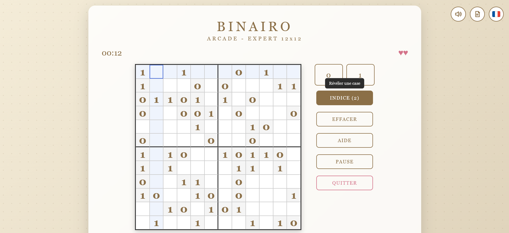

# Binairo / Takuzu

**A complete Binairo game in a single HTML file.** No installation, no internet connection, no dependencies: open `binairo.html` in your browser, or copy it to your web server, and play.

## Play online

▶ **[Play Binairo online](https://fabrice-breizh.github.io/Selfhosted-Games-in-single-html-files/Binairo/binairo.html)**, right in your browser.

## Rules

1. Fill the grid with **0s and 1s**.
2. Each row and each column contains **as many 0s as 1s**.
3. **Never more than two** identical digits next to each other.
4. All rows are **unique**, and so are all columns.

## Game modes

| Mode | How it plays |
|------|--------------|
| 🎮 **Arcade** | The classic game: errors cost lives, hints add time. |
| 🧘 **Zen** | No pressure: infinite lives and hints. |
| ⏱️ **Time Attack** | Race against the clock: hints cost time. |
| 🖨️ **Print** | Generates ready-to-print A4 sheets, 6 puzzles per page. |

Four grid sizes: **Easy 6×6**, **Medium 8×8**, **Hard 10×10** and **Expert 12×12**.

## Keyboard shortcuts

| Key | Action |
|-----|--------|
| Arrow keys | Move around the grid |
| `0` / `1` | Fill the selected cell |
| `Delete` / `Backspace` | Clear the selected cell |
| `H` | Get a hint |
| `Space` | Pause / resume |
| `Esc` | Quit, or close a window |

## Features

- **Best times** are kept, and an unfinished game can be resumed later.
- **5 visual themes**: Classic, Sakura, Matcha, Fuji and Dark.
- **6 languages**: English, Français, Español, 中文, हिन्दी, 日本語.
- Sound effects that you can switch off.
- Works on **desktop and mobile**.

## Installation

1. Download [`binairo.html`](binairo.html) (click the file, then the **Download raw file** button).
2. Double-click it: it opens in your web browser. That's it!

To host it, copy the file to any folder served by your web server (Apache, Nginx, a NAS, a Raspberry Pi…). No database or server-side code is needed.

Your scores and settings are stored in your browser only: nothing is sent anywhere.

## Other games

Binairo is part of [Selfhosted Games in single HTML files](../), with [Sudoku](../Sudoku/) and [FabJezz](../FabJezz/).

## License

Released under the [MIT License](../LICENSE).
