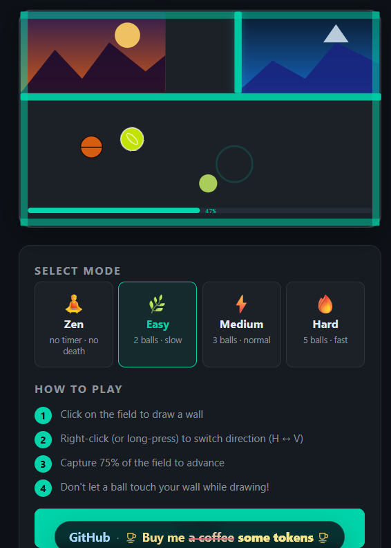

# Fab's Jezz

**A Jezzball-like arcade game in a single HTML file.** No installation, no internet connection, no dependencies: open `fabsjezz.html` in your browser, or copy it to your web server, and play.

## How to play

1. **Click** on the field to draw a wall.
2. **Right-click** (or **long-press** on a touch screen) to switch the wall direction, horizontal ↔ vertical.
3. **Capture 75%** of the field to reach the next level.
4. **Don't let a ball touch your wall** while it is being drawn, or you lose a life!

Press `Esc` or `P` to pause.

## Game modes

| Mode | Balls | Speed | Rules |
|------|-------|-------|-------|
| 🧘 **Zen** | – | – | No timer, no death: just relax |
| 🌿 **Easy** | 2 | Slow | Timer and lives |
| ⚡ **Medium** | 3 | Normal | Timer and lives |
| 🔥 **Hard** | 5 | Fast | Timer and lives |

## Features

- **Power-ups** that change the game: extra time, a ball removed (or added!), a shield, a speed wall, a freeze, and chaos.
- **Bonus lives**, and an extra minute (at the cost of a life) when time runs out.
- **Landscapes** revealed as you capture the field: lake at dusk, misty forest, snowy peak, tropical shore, lavender fields and desert dunes.
- **High scores** with level, score and capture rate.
- **5 themes**: Dark, Light, Sunset, Forest and Ocean.
- Sound effects and animations that you can switch off.
- **2 languages**: English and Français.
- Works with a **mouse or a touch screen**.

## Installation

1. Download [`fabsjezz.html`](fabsjezz.html) (click the file, then the **Download raw file** button).
2. Double-click it: it opens in your web browser. That's it!

To host it, copy the file to any folder served by your web server (Apache, Nginx, a NAS, a Raspberry Pi…). No database or server-side code is needed.

Your scores and settings are stored in your browser only: nothing is sent anywhere.

## Other games

Fab's Jezz is part of [Selfhosted Games in single HTML files](../), with [Sudoku](../Sudoku/) and [Binairo](../Binairo/).

## License

Released under the [MIT License](../LICENSE).
