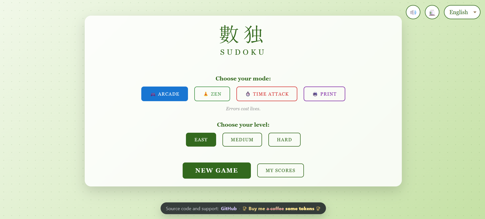
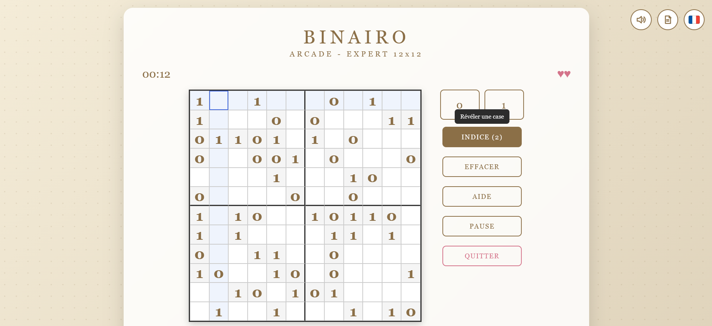
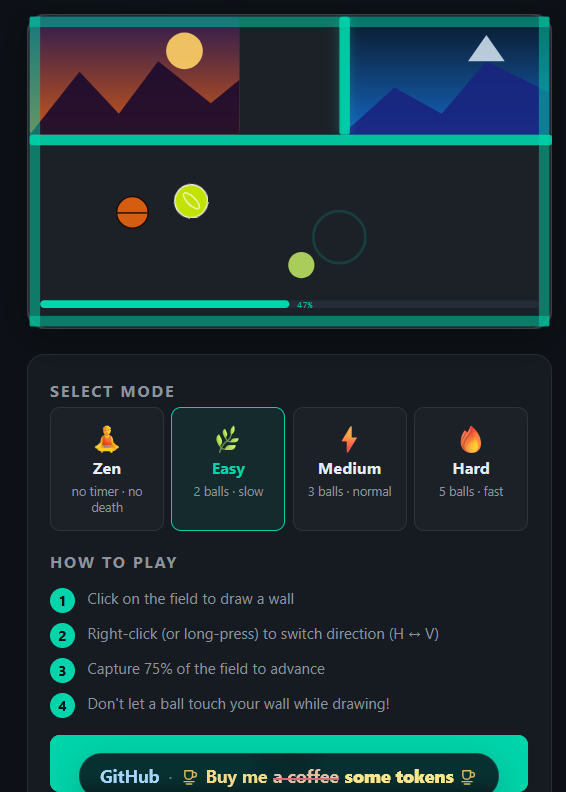

# Selfhosted Games in single HTML files

**One page, one game.** Each game is a single, self-contained HTML file: no installation, no dependencies, no build step. Copy it to your web server, or simply open it from your desktop, and play!

## The games

▶ Play online: [Sudoku](https://fabrice-breizh.github.io/Selfhosted-Games-in-single-html-files/Sudoku/sudoku.html) · [Binairo](https://fabrice-breizh.github.io/Selfhosted-Games-in-single-html-files/Binairo/binairo.html) · [Fab's Jezz](https://fabrice-breizh.github.io/Selfhosted-Games-in-single-html-files/FabJezz/fabsjezz.html)

### [Sudoku](Sudoku/)

The classic number puzzle, multilingual. Play in **Arcade** (errors cost lives), **Zen** or **Time Attack** mode, on three difficulty levels, with hints, notes, auto-notes and keyboard shortcuts. The **Print** mode generates grids to play on paper.

### [Binairo](Binairo/)

Also known as Takuzu: fill the grid with 0s and 1s following simple logic rules. Multilingual, with Arcade, Zen, Time Attack and Print modes, and four grid sizes from 6×6 to 12×12.

### [FabJezz](FabJezz/)

A Jezzball-like arcade game: draw walls to trap the bouncing balls and capture 75% of the field to reach the next level. Four modes, from a relaxed Zen mode to Hard with five fast balls.

## How to play

### On your computer
1. Download the HTML file of the game you want (open the game folder, click the file, then the **Download raw file** button).
2. Double-click the file: it opens in your web browser. That's it!

### On your web server
1. Copy the HTML file to any folder served by your web server (Apache, Nginx, a NAS, a Raspberry Pi…).
2. Open its address in your browser.

No database, no server-side code: any static file hosting works.

## Requirements

A modern web browser (Firefox, Chrome, Edge, Safari…), on desktop or mobile.

## License

These games are released under the [MIT License](LICENSE): you are free to use, copy, modify and share them.
