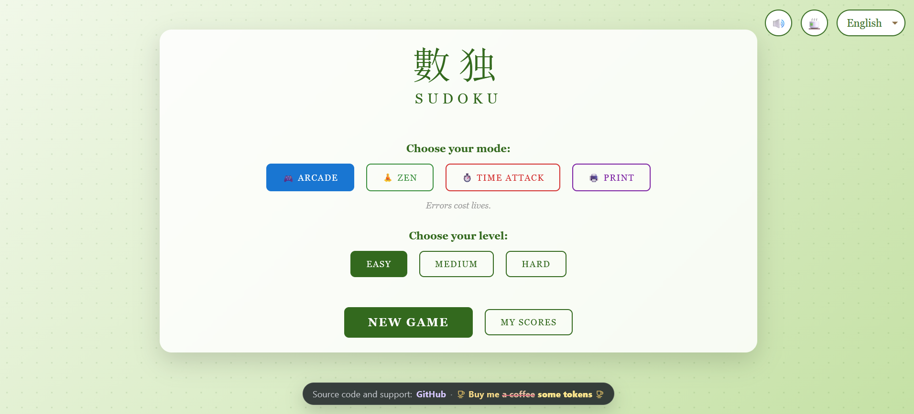

# Sudoku

**A complete Sudoku game in a single HTML file.** No installation, no internet connection, no dependencies: open `sudoku.html` in your browser, or copy it to your web server, and play.

## Play online

▶ **[Play Sudoku online](https://fabrice-breizh.github.io/Selfhosted-Games-in-single-html-files/Sudoku/sudoku.html)**, right in your browser.

## Game modes

| Mode | How it plays |
|------|--------------|
| 🎮 **Arcade** | The classic game: errors cost lives. |
| 🧘 **Zen** | No pressure: infinite lives and hints. |
| ⏱️ **Time Attack** | Race against the clock: hints cost time. |
| 🖨️ **Print** | Generates ready-to-print A4 PDF grids, 6 puzzles per page, with or without candidates. |

Each mode comes in three levels: **Easy**, **Medium** and **Hard**.

## Features

- **Help when you need it**: hints that reveal a cell, a draft mode for your own notes, auto-notes that fill in all candidates, and safe moves that fill the obvious cells.
- **Best times**: your best times are kept, and an unfinished game can be resumed later.
- **Keyboard shortcuts**: digits `1`–`9` to fill a cell, `0` or `Backspace` to erase, arrow keys to move, `D` for notes, `H` for a hint, `Space` to pause, `Esc` to quit.
- **6 languages**: English, Français, Español, 中文, हिन्दी, 日本語.
- **6 visual themes**: Light, Dark, Classic, Fuji, Matcha and Sakura, plus sound effects that you can switch off.
- Works on **desktop and mobile**.

## How to play

1. Download [`sudoku.html`](sudoku.html) (click the file, then the **Download raw file** button).
2. Double-click it: it opens in your web browser. That's it!

To host it, copy the file to any folder served by your web server (Apache, Nginx, a NAS, a Raspberry Pi…). No database or server-side code is needed.

Your scores and settings are stored in your browser only: nothing is sent anywhere.

## Other games

Sudoku is part of [Selfhosted Games in single HTML files](../), with [Binairo](../Binairo/) and [FabJezz](../FabJezz/).

## License

Released under the [MIT License](../LICENSE).
